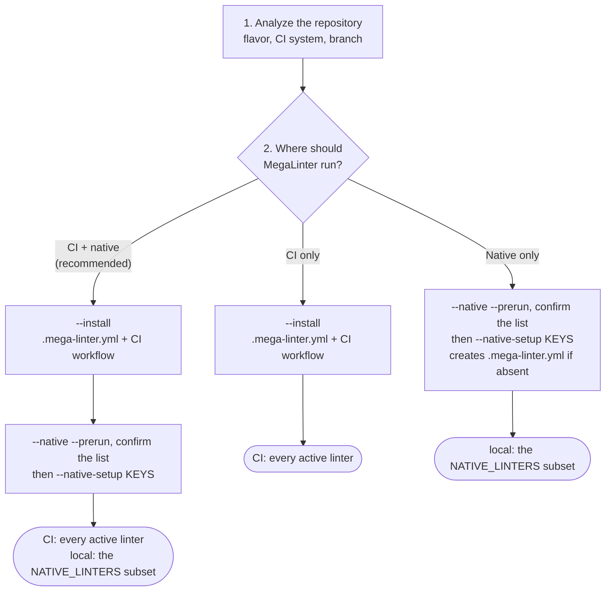

<!-- markdownlint-disable MD013 -->
<!-- @generated by .automation/build.py, please don't update manually -->
<!-- install-agent-skills-section-start -->

# Coding agents (skills)

MegaLinter ships [**agent skills**](https://github.com/oxsecurity/megalinter/tree/main/skills) making it easy to drive from coding agents like **Claude Code, Cursor CLI, GitHub Copilot CLI, Codex, Antigravity or OpenCode**:

With **Claude Code** (the skills are copied directly into `.claude/skills/`):

```bash
npx skills add oxsecurity/megalinter/skills -s '*' -a claude-code -y
```

With **another coding agent**, replace `claude-code` with your agent's identifier (`cursor`, `github-copilot`, `codex`, `antigravity`, `opencode`... full list in the [skills CLI documentation](https://github.com/vercel-labs/skills#supported-agents)) — or let the CLI **detect your installed agents** and install the skills for all of them at once:

```bash
npx skills add oxsecurity/megalinter/skills -s '*' -y --copy
```

Then just ask your agent to _"setup megalinter"_ or _"run megalinter and fix the errors"_. The skills handle:

- **megalinter-setup**: install or upgrade MegaLinter on the repository (non-interactive `npx mega-linter-runner --install`)
- **megalinter-check**: watch MegaLinter CI jobs (GitHub Actions, GitLab CI, Azure Pipelines, Bitbucket Pipelines) or run locally with Docker
- **megalinter-fix**: apply fixes guided by per-linter fix guides, with user confirmation before disabling anything or pushing
- **megalinter**: orchestrate the whole check → fix → re-check loop

The skills only call `mega-linter-runner`, never the `megalinter` engine directly, so the machine needs Node.js and Docker (or uv for [native mode](https://megalinter.io/latest/install-native/)), but no Python install.

**megalinter-setup** asks where MegaLinter should run: in CI, natively on your machine, or both (recommended). CI keeps running every active linter, and `NATIVE_LINTERS` only scopes the fast local runs, so keep the slow and whole-repository linters out of it.



On coding agents supporting sub-agents (Claude Code, OpenCode, GitHub Copilot custom agents...), dedicated MegaLinter sub-agents (running on low-cost models) watch CI jobs and digest linter outputs to keep large logs out of your agent's context, and fix several linters in parallel.


<!-- install-agent-skills-section-end -->
