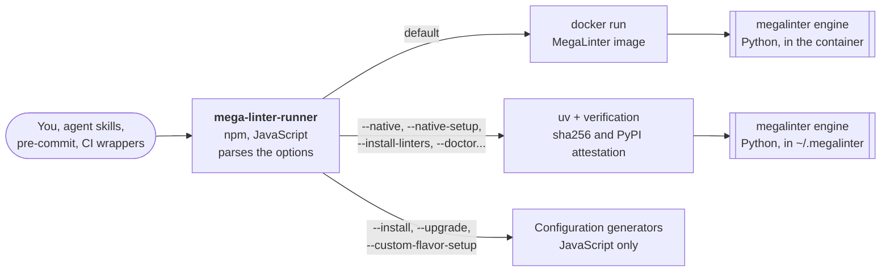

<!-- markdownlint-disable MD013 -->
<!-- @generated by .automation/build.py, please don't update manually -->
<!-- install-locally-section-start -->

# Run MegaLinter locally

[](https://npmjs.org/package/mega-linter-runner)
[](https://npmjs.org/package/mega-linter-runner)
[](https://npmjs.org/package/mega-linter-runner)

Use [mega-linter-runner](https://megalinter.io/mega-linter-runner/) to run MegaLinter locally with the same configuration defined in your [.mega-linter.yml](config-file.md) file.

See the [mega-linter-runner installation instructions](https://megalinter.io/mega-linter-runner/#installation).

Example:

```shell
npx mega-linter-runner --flavor salesforce -e "'ENABLE=DOCKERFILE,MARKDOWN,YAML'" -e 'SHOW_ELAPSED_TIME=true'
```

Note: You can also use this command line in your custom CI/CD pipelines.

## How mega-linter-runner and megalinter fit together

Two programs, one job each:

- `mega-linter-runner` (npm, JavaScript) is the launcher you type. It also sets up your repository (`--install`, `--upgrade`).
- `megalinter` (PyPI, Python) is the engine that lints. It runs inside the Docker image, or, in [native mode](https://megalinter.io/latest/install-native/) (beta), in a verified copy that the runner installs on your machine.



| You need                                          | Install                                      | Node.js | Docker | uv  |
|:--------------------------------------------------|:---------------------------------------------|:-------:|:------:|:---:|
| Run MegaLinter in a container (default)           | nothing but the runner                       |   yes   |  yes   | no  |
| Run MegaLinter without Docker (beta)              | the runner downloads and verifies the engine |   yes   |   no   | yes |
| Create or upgrade `.mega-linter.yml` and CI files | nothing but the runner                       |   yes   |   no   | no  |

You never need to call `megalinter` yourself: the runner translates its options into the engine's arguments and environment variables. A copy installed by hand (`uv tool install megalinter --pre`) is only a shortcut: the runner does not verify it.


<!-- install-locally-section-end -->
