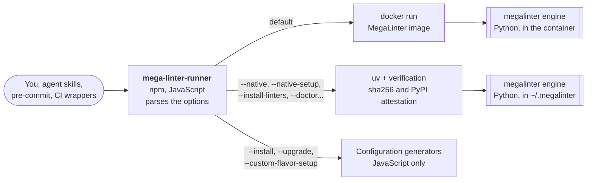

<!-- markdownlint-disable MD013 -->

# Native mode (without Docker)

> **Beta:** native mode is in beta. [Docker](install-docker.md) remains the default and the recommended way to run MegaLinter, especially on code you do not fully trust: linters (and the configuration files they load) can execute the code of the analyzed repository, and in Docker this happens inside a container.

MegaLinter can run directly on your machine, without a container engine and without downloading a multi-GB image. Only the linters you list are installed, so a run starts in seconds.

Supported platforms: Linux (x86-64 and ARM64), macOS (Apple Silicon), Windows with Git Bash, and WSL (Linux). Intel Macs are not supported: `cryptography`, needed to verify the MegaLinter package, no longer publishes builds for them. Use Docker there.

## Quick start

Requirements:

- [uv](https://docs.astral.sh/uv/getting-started/installation/) (Windows: `winget install --id astral-sh.uv -e`, macOS: `brew install uv`)
- Node.js, to run `mega-linter-runner`, the launcher that downloads, verifies and calls the MegaLinter engine (see [how the pieces fit](#how-the-runner-and-megalinter-fit-together))
- Windows only: [Git for Windows](https://git-scm.com/download/win) (Git Bash), `winget install --id Git.Git -e`

Set up native mode in one command:

```shell
npx mega-linter-runner@beta --native-setup
```

It analyzes your repository, proposes the linters to run on your machine, writes them in `NATIVE_LINTERS` (your comments and the rest of `.mega-linter.yml` are kept), installs them and runs a first lint. In a terminal, it asks you to confirm or edit the proposed list. Give the linter keys as arguments to skip the question (`--native-setup PYTHON_BLACK MARKDOWN_MARKDOWNLINT`).

Then lint whenever you want:

```shell
npx mega-linter-runner@beta --native
```

To do it by hand instead:

1. List the linters allowed to run natively in your `.mega-linter.yml`:

    ```yaml
    NATIVE_LINTERS:
      - PYTHON_BLACK
      - JAVASCRIPT_ES
      - MARKDOWN_MARKDOWNLINT
    ```

2. Install them, then run:

    ```shell
    npx mega-linter-runner@beta --install-linters
    npx mega-linter-runner@beta --native
    ```

While native mode is in beta, use the beta of `mega-linter-runner` (`@beta`): released versions older than native mode do not know these options. Native mode uses the latest beta of MegaLinter by default: pass `--release <version>` only to pin an exact version.

The linter keys are the ones used everywhere else in MegaLinter (`ENABLE_LINTERS`, `DISABLE_LINTERS`...). Each [linter page](supported-linters.md) has a "native mode" section with its key and the platforms it supports.

## How the runner and megalinter fit together

Two programs, one job each:

- `mega-linter-runner` (npm, JavaScript) is the launcher you type. It also sets up your repository (`--install`, `--upgrade`).
- `megalinter` (PyPI, Python) is the engine that lints. In native mode, the runner downloads it, verifies it (sha256 and PyPI attestation), installs it in `~/.megalinter/core/<version>/venv`, then calls it for you.

Node.js is needed only for the launcher. In Docker mode, the engine runs inside the image, so nothing else is installed on your machine.



You never need to call `megalinter` yourself: the runner translates its options into the engine's arguments and environment variables (`--fix` sets `APPLY_FIXES`, `--linter` sets `NATIVE_LINTERS`...).

### Which "install" do I need?

| Option              | What it does                                                                    | Mode   |
|:--------------------|:--------------------------------------------------------------------------------|:-------|
| `--install`         | Creates `.mega-linter.yml` and CI workflow files                                | any    |
| `--upgrade`         | Upgrades those files to the latest version                                      | any    |
| `--native-setup`    | Picks the linters, writes `NATIVE_LINTERS`, installs them and runs a first lint | native |
| `--install-linters` | Installs the linter tools on this machine                                       | native |

## Native mode next to CI

Native mode does not replace your CI job: the recommended setup is **both**. CI keeps running every active linter in Docker, and your machine runs the `NATIVE_LINTERS` subset in seconds (agent fix loops, pre-commit hooks, local checks). A green native run is therefore not a green CI: the linters it skips are left to CI.

Without a CI job, native mode works alone: `--native-setup` creates `.mega-linter.yml` when it does not exist. To add CI later, run `npx mega-linter-runner --install`: it backs up `.mega-linter.yml` as `.megalinter-setup.bak`, so copy your `NATIVE_LINTERS` back from it.

The [agent skills](install-agent-skills.md) ask which of the three you want (CI, native, or both) when they set MegaLinter up.

## NATIVE_LINTERS: explicit opt-in

Nothing runs natively unless it is listed in `NATIVE_LINTERS`. A linter that is activated by your configuration but not listed is skipped, so you can keep running a larger set of linters in Docker or in CI.

The special value `all` means every linter matching your configuration:

```yaml
NATIVE_LINTERS:
  - all
```

**Using `all` is discouraged.** It installs many linters, which is slow, and you must fully trust the security of every one of them. Prefer listing the linters you need.

## Which linters to run natively

`NATIVE_LINTERS` is usually a subset of what your CI runs. CI keeps running every active linter: the variable only scopes the runs on your machine, where you want fast feedback. The slow linters (spell checkers, type checkers, link checkers) and the ones scanning the whole repository (secret and vulnerability scanners, copy-paste detection) are better left to CI.

`npx mega-linter-runner@beta --native --prerun` shows the proposal without running or installing anything, and `--native-setup` applies it. A linter is proposed for your machine unless:

- it is not available natively on your platform, or the tool it needs from your machine is missing
- it runs in project mode (it scans the whole repository)
- it took 10 seconds or more on your last run (the report of the previous run is read), or, when it has not run yet, its `linter_speed` is 2 or less (out of 5). The first run after a linter is installed is slower than the next ones, so it is not counted

The linters left to CI are listed with their reason, and in the console of each run (`Skipped linters (not listed in NATIVE_LINTERS)`). A green native run is not a green CI: the skipped linters still run there.

## What is installed, and how

Linters are installed in `~/.megalinter` (change it with `MEGALINTER_HOME`), without administrator rights and without touching your system:

| Kind of linter             | Installation                                                                           |
|:---------------------------|:---------------------------------------------------------------------------------------|
| Python tools               | A virtual environment per linter, from pinned packages with hashes                     |
| Node.js tools              | A folder per linter, from a pinned lock file, without running install scripts          |
| Binaries and jars          | The official release asset, checked against a pinned sha256                            |
| Tools provided by the host | Not downloaded: MegaLinter looks for them on your `PATH` and shows how to install them |

Every download is verified. Upstream signatures and checksums (GitHub attestations, cosign, GPG, release checksum files) are checked when the pinned versions are generated in CI, and the installer only downloads files whose sha256 is pinned in the lock files shipped with MegaLinter. A file that does not match is refused.

## Language runtimes

Some linters need a runtime (Node.js, Java, .NET, Go, PowerShell, Dart, PHP...). MegaLinter uses the one installed on your machine when its version is suitable. Otherwise, `NATIVE_INSTALL_RUNTIMES` decides:

| Value           | Behavior                                                                                 |
|:----------------|:-----------------------------------------------------------------------------------------|
| `ask` (default) | Proposes to install the runtime in `~/.megalinter/runtimes` (interactive terminals only) |
| `auto`          | Installs it without asking                                                               |
| `never`         | Prints how to install it yourself                                                        |

Ruby, R and Rust have no portable, verifiable download: install them with your package manager.

## Corporate proxies

Downloads go through `HTTP_PROXY` / `HTTPS_PROXY`. When your network or antivirus inspects HTTPS connections (uv fails with `invalid peer certificate: UnknownIssuer`), tell the installers to trust the certificates of your system:

```shell
export UV_NATIVE_TLS=1             # uv (MegaLinter itself and Python linters)
export NODE_USE_SYSTEM_CA=1        # Node.js linters
```

`SSL_CERT_FILE`, `REQUESTS_CA_BUNDLE`, `NODE_EXTRA_CA_CERTS`, `PIP_CERT` and `NPM_CONFIG_CAFILE` are given to the installers too.

## Security model

- Commands declared by the analyzed repository (`PRE_COMMANDS`, `POST_COMMANDS`), `PLUGINS` and remote `EXTENDS` are **ignored** in native mode, because they would run on your machine with your privileges. Use `--trust-repo-commands` (or `NATIVE_TRUST_REPO_COMMANDS=true` in the environment, never in `.mega-linter.yml`) only for a repository you fully trust. It is not available with `--native-setup`: set up native mode first, then run `--native --trust-repo-commands`.
- Linters only receive an allowlist of system environment variables, so the secrets of your machine (cloud credentials, tokens...) do not leak to them. Add more with `NATIVE_ENV_ALLOWLIST`.
- Native mode refuses to run when `MEGALINTER_HOME` belongs to another user or is writable by others.
- The `megalinter` Python package is installed by `mega-linter-runner` after checking its PyPI attestation: it must have been published by the release workflow of the MegaLinter repository.

## Commands

Run everything through `mega-linter-runner`, which calls the `megalinter` engine for you:

| From the runner                                 | What it does                                                                                    |
|:------------------------------------------------|:------------------------------------------------------------------------------------------------|
| `mega-linter-runner --native-setup [KEY...]`    | Choose the linters to run natively, write `NATIVE_LINTERS`, install them and run a first lint   |
| `mega-linter-runner --native --prerun`          | Suggest the linters to run natively, and configuration improvements, without running any linter |
| `mega-linter-runner --native`                   | Lint the current folder with the linters of `NATIVE_LINTERS`                                    |
| `mega-linter-runner --install-linters [KEY...]` | Install the given linters, or the ones of `NATIVE_LINTERS`                                      |
| `mega-linter-runner --uninstall-linters KEY...` | Remove installed linters                                                                        |
| `mega-linter-runner --list-linters [--json]`    | Show the native status of every linter                                                          |
| `mega-linter-runner --doctor`                   | Check Git Bash, uv, runtimes and the install folder                                             |
| `mega-linter-runner --prune-cache`              | Empty the download and linter caches                                                            |

The engine installed by the runner is not on your `PATH`. As a shortcut, you can install your own copy with `uv tool install megalinter --pre` and call the same commands directly (`megalinter setup [--linters KEY,KEY] [--no-run]`, `megalinter prerun`, `megalinter run`, `megalinter install-linters`, `megalinter uninstall-linters`, `megalinter list-linters`, `megalinter doctor`, `megalinter cache prune`). The runner does not verify this copy, and it has none of the runner's conveniences: `--fix`, `--filesonly`, `--debug` and `--linter` are runner options that become environment variables (`APPLY_FIXES`, `SKIP_CLI_LINT_MODES`, `LOG_LEVEL`, `NATIVE_LINTERS`).

### Reports for tools and coding agents

`run` and `setup` accept `--json` (equivalent to `JSON_REPORTER=true`) and `--sarif` (equivalent to `SARIF_REPORTER=true`); `mega-linter-runner` has the same options. With both, `megalinter-reports/mega-linter-report.json` gives each linter's findings (`file`, `line`, `column`, `rule`, `level`, `message`) next to its status, whether it is blocking, and its time. It also lists the `skipped_linters` with their reason, and the `tips` met during the run (performance advice, deprecations, timeouts). The linters that did not produce SARIF have no `findings`.

### Faster commands

`npx` checks its copy of `mega-linter-runner` and of its dependencies on each call, which adds several seconds to every run. When you run MegaLinter often, install the runner once:

```shell
npm install -g mega-linter-runner@beta
mega-linter-runner --native --release beta
```

Upgrade it with the same `npm install -g` command.

With `--release beta`, the runner looks for a new beta on PyPI at most once an hour: the runs in between start the installed beta without downloading the list of releases. Pass an exact version to `--release` to never contact PyPI once it is installed.

MegaLinter runs the linters in parallel **threads**: they start instantly, where a worker process loaded MegaLinter again (about a second on Windows and macOS). Each linter still runs in its own process, so the linters use all your cores.

## Pre-commit hook

Native mode makes MegaLinter fast enough to run on each commit with [pre-commit](https://pre-commit.com/):

```yaml
repos:
  - repo: https://github.com/oxsecurity/megalinter
    rev: vX.Y.Z # Git tag of a MegaLinter version that includes native mode
    hooks:
      - id: megalinter-native-incremental # Changed files only, skips the linters that run in project mode
        stages:
          - pre-commit
      - id: megalinter-native-full # Also runs the linters that run in project mode
        stages:
          - pre-push
```

- Only the linters of `NATIVE_LINTERS` run, on the files of the commit, and their fixes are applied
- The hooks of `rev: vX.Y.Z` run version X.Y.Z of `mega-linter-runner` and of MegaLinter. pre-commit installs the runner once (Node.js is required), instead of resolving it with npx on each commit
- Install the linters once with the same version: `npx mega-linter-runner@X.Y.Z --install-linters --release X.Y.Z`, as a hook can not ask whether to install a missing language runtime
- `megalinter-incremental` and `megalinter-full` are the same hooks with Docker

## Configuration

| Variable                      | Default         | Description                                                              |
|:------------------------------|:----------------|:-------------------------------------------------------------------------|
| `NATIVE_LINTERS`              | empty           | Linters allowed to run natively (keys, or `all`)                         |
| `NATIVE_INSTALL_RUNTIMES`     | `ask`           | `ask`, `auto` or `never`                                                 |
| `NATIVE_MISSING_LINTERS`      | `install`       | `install`, `skip` or `fail` for a listed linter that is not installed    |
| `NATIVE_ENV_ALLOWLIST`        | empty           | Extra environment variables given to the linters                         |
| `NATIVE_IGNORE_HOST_RUNTIMES` | `false`         | Ignore the runtimes installed on the host                                |
| `NATIVE_OFFLINE`              | `false`         | Install only from the local download cache                               |
| `NATIVE_LINTER_CACHE`         | `true`          | Let eslint, prettier, stylelint and cspell keep their cache between runs |
| `NATIVE_RESULTS_CACHE`        | `true`          | Do not lint again the unchanged files linted without any problem         |
| `MEGALINTER_HOME`             | `~/.megalinter` | Where linters, runtimes and downloads are stored                         |

When MegaLinter runs in Docker and your `.mega-linter.yml` has no `NATIVE_LINTERS`, its reports suggest trying native mode. Define `NATIVE_SUGGESTIONS: false` to hide this suggestion.

## Faster repeated runs

Native mode keeps data between runs that a Docker container loses, so the next runs are faster:

- **Results cache**: the files a linter found without any problem are not linted again while they, the linter, its arguments and its configuration files stay the same. Only for linters whose result on a file depends on nothing else than its content and its configuration: black, flake8, yamllint, markdownlint, jsonlint and prettier. A run that finds problems still caches the files the linter did not report, and files with warnings are always linted again. The configuration files the linters find by themselves are watched in the folders of the linted files and in all their parents, above the workspace too. User-level configuration (for example `~/.config/black`) is not watched: run `megalinter cache prune` after changing it. Disable the cache with `NATIVE_RESULTS_CACHE: false`, or for one linter with `<LINTER_KEY>_NATIVE_RESULTS_CACHE: false`
- **Linter caches**: eslint, prettier, stylelint and cspell keep their own cache of results, in `~/.megalinter/cache/linters` (never in your repository), and analyze again only the files that changed. Disable it with `NATIVE_LINTER_CACHE: false`, or for one linter with `<LINTER_KEY>_NATIVE_CACHE: false` (example: `JAVASCRIPT_ES_NATIVE_CACHE: false`). The eslint cache is off for TypeScript (`TYPESCRIPT_ES`, `TSX_ES`), and for any eslint configuration enabling type-aware rules (`projectService`, `parserOptions.project`, `*TypeChecked` configs), whose results depend on other files. If your type-aware rules come from a shared configuration package, disable it with `JAVASCRIPT_ES_NATIVE_CACHE: false`
- black uses its own cache too (in your user cache folder)
- `megalinter cache prune` empties the caches kept in `~/.megalinter`

## Differences with Docker

- Results can differ from Docker: operating system, tool versions provided by the host, file system case sensitivity and path separators.
- Linters installed by MegaLinter always run the version pinned for your MegaLinter version, as in its Docker image. After a MegaLinter upgrade, they are reinstalled at their new version on the next run.
- Tools provided by the host (SwiftLint, Raku, scalafix, xmllint, cppcheck...) run the version installed on your machine. When MegaLinter's Docker image pins a different version, a warning shows both versions. `megalinter list-linters` shows which linters use the version installed on your machine.
- Some linters are not available natively on every platform, with the reason shown in their documentation page and by `megalinter list-linters`. Use Docker for those.
- Flavors do not apply: you choose the linters one by one.
