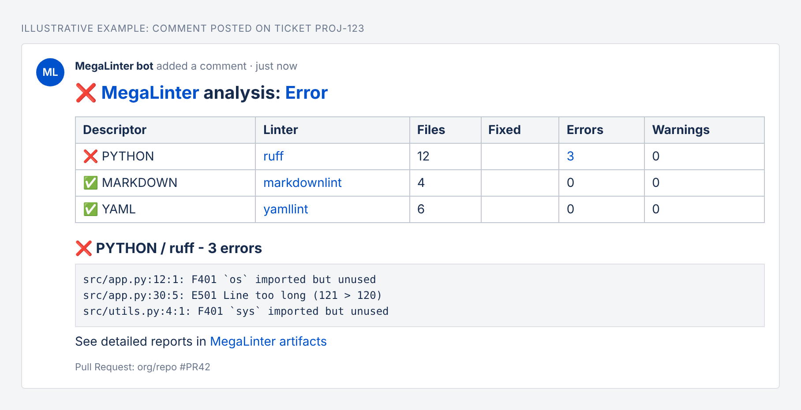

<!-- markdownlint-disable MD013 MD033 MD041 -->
# Jira Reporter

Posts MegaLinter results summary as a comment on the **Jira ticket(s)** referenced by the labels of the related Pull Request / Merge Request.

It works with GitHub Pull Requests, GitLab Merge Requests and Azure DevOps Pull Requests, as all of them support labels. It uses [atlassian-python-api](https://github.com/atlassian-api/atlassian-python-api).

## Usage



_Illustrative example of the comment posted on a Jira ticket_

Add a label named after the Jira ticket key (ex: `PROJ-123`) to your Pull Request. At the end of the MegaLinter run, a comment containing the lint results summary and a link to the detailed logs is posted on the ticket.

- Several labels referencing different tickets post the comment on each of them
- Labels that do not look like a Jira key are ignored
- By default, labels `PROJ-123`, `jira:PROJ-123` and `jira/PROJ-123` are recognized. Change this with `JIRA_REPORTER_LABEL_REGEX` (the first capturing group, if any, must contain the ticket key)
- The comment contains the same summary as the other Pull Request comment reporters, converted to Jira wiki markup. Use `REPORTERS_MARKDOWN_SUMMARY_TYPE` to choose between `sections`, `table` or both
- Future MegaLinter runs update the existing Jira comment instead of posting a new one. Set `JIRA_REPORTER_OVERWRITE_COMMENT` to `false` to post a new comment each time

### Custom label regex examples

`JIRA_REPORTER_LABEL_REGEX` is a regular expression matched against the whole label. If it has a capturing group, the first group is the ticket key (converted to upper case), otherwise the whole label is used.

| Label convention  | `JIRA_REPORTER_LABEL_REGEX`                          | Matches (ticket key)        |
|-------------------|------------------------------------------------------|-----------------------------|
| Default           | `^(?:jira[:/])?([A-Za-z][A-Za-z0-9_]+-\d+)$`         | `PROJ-123`, `jira:PROJ-123` |
| Prefix `ticket-`  | `^ticket-([A-Za-z][A-Za-z0-9_]+-\d+)$`               | `ticket-PROJ-123`           |
| Prefix `jira_`    | `^jira_([A-Za-z][A-Za-z0-9_]+-\d+)$`                 | `jira_PROJ-123`             |
| Label with space  | `^Jira: ([A-Za-z][A-Za-z0-9_]+-\d+)$`                | `Jira: PROJ-123`            |
| Only some projects | `^((?:PROJ\|OPS)-\d+)$`                             | `PROJ-1`, `OPS-42` only     |
| Key anywhere in label | `(?i)\b([A-Z][A-Z0-9_]+-\d+)\b`                  | `fix-PROJ-123-login`        |

Example in `.mega-linter.yml`:

```yaml
JIRA_REPORTER_LABEL_REGEX: '^ticket-([A-Za-z][A-Za-z0-9_]+-\d+)$'
```

## Configuration

Jira Cloud:

- Create an [API token](https://support.atlassian.com/atlassian-account/docs/manage-api-tokens-for-your-atlassian-account/)
- Define `JIRA_URL` (ex: `https://mycompany.atlassian.net`), `JIRA_USERNAME` (account e-mail) and `JIRA_API_TOKEN` as masked CI/CD variables

Jira Server / Data Center:

- Create a [Personal Access Token](https://confluence.atlassian.com/enterprise/using-personal-access-tokens-1026032365.html)
- Define `JIRA_URL` and `JIRA_PERSONAL_ACCESS_TOKEN` as masked CI/CD variables

The Pull Request labels are read with the platform token already used by the comment reporters: `GITHUB_TOKEN` (permission `pull-requests: read`), `CI_JOB_TOKEN` / `GITLAB_ACCESS_TOKEN_MEGALINTER`, or `SYSTEM_ACCESSTOKEN`.

| Variable                          | Description                                                                                           | Default value                                   |
|-----------------------------------|-------------------------------------------------------------------------------------------------------|-------------------------------------------------|
| JIRA_REPORTER                     | Activates/deactivates reporter                                                                        | `true` (active only if Jira variables are set)  |
| JIRA_URL                          | Jira base URL                                                                                         | <!-- -->                                        |
| JIRA_USERNAME                     | Jira Cloud account e-mail                                                                             | <!-- -->                                        |
| JIRA_API_TOKEN                    | Jira Cloud API token                                                                                  | <!-- -->                                        |
| JIRA_PERSONAL_ACCESS_TOKEN        | Jira Server / Data Center Personal Access Token                                                       | <!-- -->                                        |
| JIRA_REPORTER_LABEL_REGEX         | Regular expression matching the labels that reference a ticket                                        | `^(?:jira[:/])?([A-Za-z][A-Za-z0-9_]+-\d+)$`    |
| JIRA_REPORTER_OVERWRITE_COMMENT   | Set to false to not overwrite existing comments in case of new runs on the same ticket                | `true`                                          |
| REPORTERS_ACTION_RUN_URL          | Override default URL of the CI job visualization page                                                 | <!-- -->                                        |
| MEGALINTER_MULTIRUN_KEY           | Key to identify multirun when multiple MegaLinter runs are executed in the same pipeline (ex: `java`) | <!-- -->                                        |
