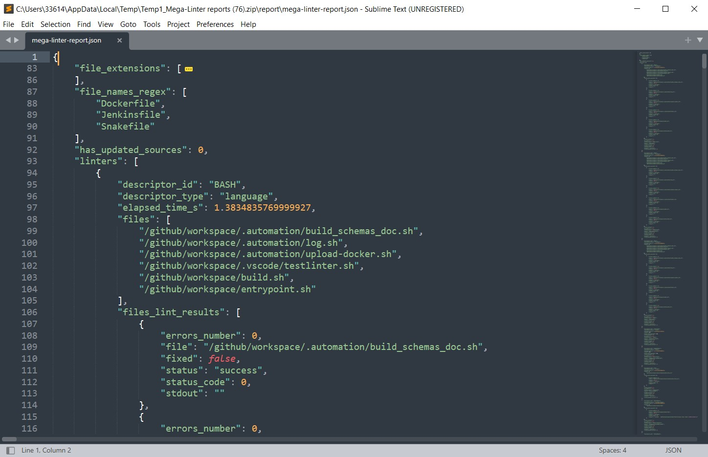

# JSON Reporter

Generates a full execution log in JSON format within a file named **mega-linter-report.json** , located in report folder

This reporter **is deactivated by default**.

## Usage

Activate the reporter (`JSON_REPORTER: true`) to generate JSON report file

## Configuration

| Variable                    | Description                           | Default value           |
|-----------------------------|---------------------------------------|-------------------------|
| JSON_REPORTER               | Activates/deactivates reporter        | false                   |
| JSON_REPORTER_OUTPUT_DETAIL | "simple" or "detailed"                | simple                  |
| JSON_REPORTER_FILE_NAME     | File name for JSON report output file | mega-linter-report.json |

## Content for tools and coding agents

The report is read by tools and coding agents, so the fields they need are available without parsing the logs:

- `linters[].blocking`: `false` when the errors of the linter do not fail the run (`DISABLE_ERRORS`, `DISABLE_ERRORS_IF_LESS_THAN`)
- `linters[].findings`: the problems found, as `file`, `line`, `column`, `rule`, `level` and `message`. Present when the SARIF report is also activated (`SARIF_REPORTER: true`), for the linters that produce SARIF
- `skipped_linters`: the linters that did not run, with their `reason` (not listed in `NATIVE_LINTERS`, not installed, disabled, excluded CLI lint mode)
- `tips`: the advice met during the run, with a `category` (`performance`, `activation`, `deprecation`, `timeout`, `native`) and a `message`
- `linters[].native_first_run`: `true` for the first run of a linter just installed by [native mode](../install-native.md), much slower than the next ones
